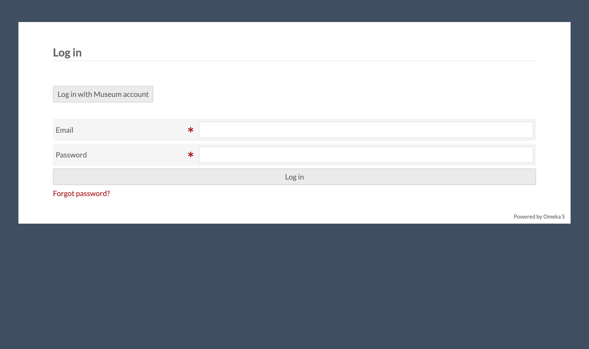
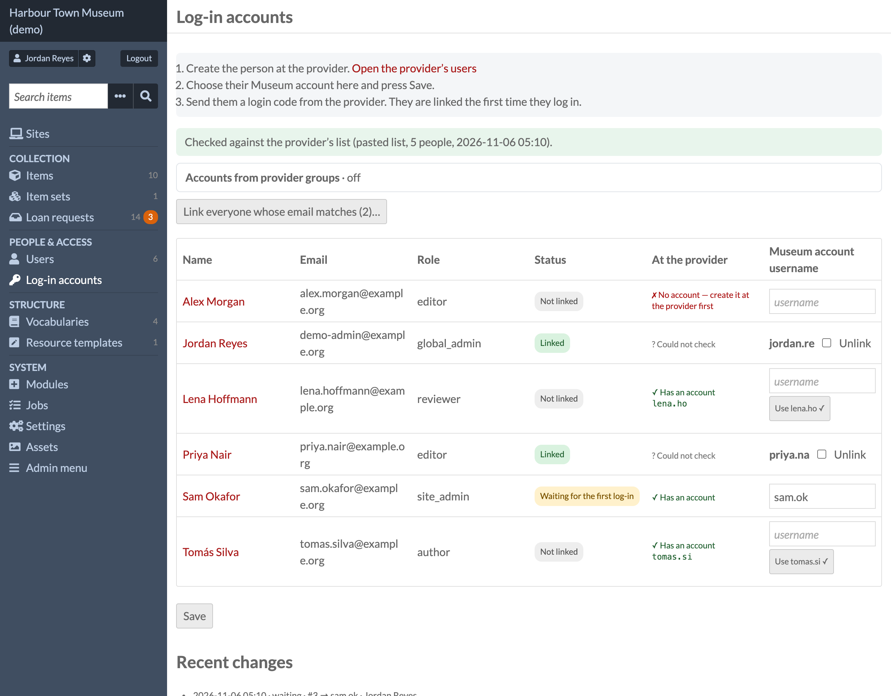
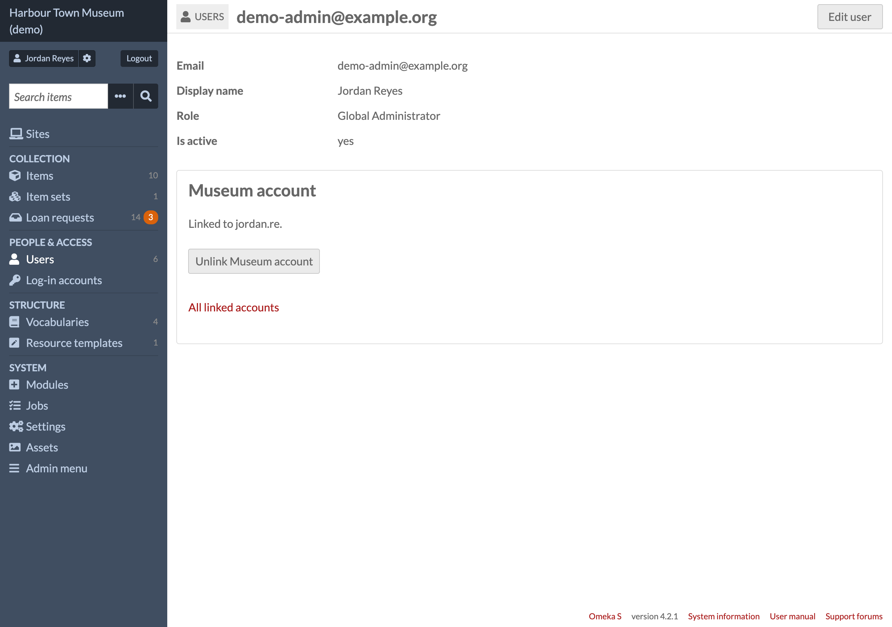

# OpenID Connect Log In

**OpenID Connect Log In** is an Omeka S module for **single sign-on (SSO) with an OpenID Connect
(OIDC) provider** — Keycloak, Pocket ID, Authentik and others. It adds a **"Log in with …"
button** to the login page **next to** the normal password log-in, which is never removed, so
the site stays reachable when the provider is down. People **link their own account**, or an
administrator types each person's provider username; optionally, **provider groups** create
users and set their **Omeka role**. Logging out ends the provider's session too.



- Omeka S 4.x · no other module required
- Licence: GPL-3.0-or-later (see `LICENSE`)
- Issues and questions: https://github.com/phumraphee/OidcLogin/issues

## Screenshots

**Log-in accounts** (`/admin/oidc-login`) — every user, whether they are linked, whether the
provider knows them, and the provider username each will use; the first log-in with it links.



**A user's page** — the box named after the account, to link or unlink it.



## Where to find it

- The button: on Omeka's login page (`/login`), above the password form.
- **Log-in accounts** under MODULES in the left menu (`/admin/oidc-login`): every user, linked or not, with the
  provider username each will use. Global administrators only.
- Each user's page: a box named after the account, to link or unlink it.
- Settings: Admin → Modules → **OpenID Connect Log In** → Configure.

## What it does

- Authorization code flow with PKCE (S256), state and nonce; tokens are fetched on the
  server with the client secret.
- Checks the ID token (issuer, audience, nonce, expiry) and the userinfo answer
  (same subject, allowed groups, `email_verified`).
- **By default nobody is created and no role changes** (see *Accounts from provider groups*
  for the option that does). People link their own account (log in with
  the password, "My account", "Link …"), or a global admin types each person's provider
  username on *Log-in accounts* (`/admin/oidc-login`); the first log-in with it links.
  Afterwards only that same provider subject can use the Omeka account.
- Users that Omeka has deactivated cannot log in this way.
- Logs in exactly like Omeka's `/login`: new session id, identity in Omeka's
  authentication storage, `user.login` event.
- **Account name** (English, Thai): what people call their provider account, e.g.
  "Example account". The button ("Log in with Example account") and every message
  use it. Thai is shown to browsers that ask for Thai first.

## Install
1. Unzip into `modules/OidcLogin` (the folder name must stay exactly that).
2. At the provider, create a confidential client with redirect URI
   `https://<your site>/oidc/callback`, scopes `openid profile email groups`.
3. In `config/local.config.php`:
   ```php
   'oidclogin' => ['client_id' => '…', 'client_secret' => '…'],
   ```
4. Admin → Modules → **OpenID Connect Log In** → Install, then Configure: issuer, redirect
   URI, allowed groups, account name, button text. To update, replace the folder and press
   Upgrade.

Nothing is created in the database but Omeka settings and user settings (`oidclogin_*`).

## Accounts from provider groups (off by default)
On **Log-in accounts** (`/admin/oidc-login`), a table *provider group → Omeka role* and a switch.
When it is on, someone who logs in with the provider and is not linked here yet:
- is let in only if one of their groups (the `groups` claim; scope `groups`) is in the table —
  otherwise refused, with a line that says so;
- is linked to the **one** user here with the same email address (compared without case; the
  provider must say `email_verified`), or — when there is none — gets a new user (name and email
  from the provider, active, no password). Two users with that email, a deactivated user, a user
  linked to another account or waiting for another username: refused, nothing changes;
- gets the **highest** role of their mapped groups. *Global Administrator* only from a row that
  says so.

Users made or linked this way are marked (user setting `oidclogin_managed`) and their role is set
again from their groups at every log-in, before Omeka hears of it (so the session length that
goes with the role is the new one). Out of every mapped group: they cannot log in; the user is
kept. A user Omeka has deactivated is never turned back on. Users linked by hand (or by the
admin's waiting usernames) are never changed. Every creation, link and role change is in the
page's history and the PHP error log. Switch off: the module works exactly as 1.0.0.

**Matching by email is safe only if people cannot change their own email at the provider.**
In Pocket ID: *Application Configuration → Enable self-account editing* **off**. Otherwise anyone
could give themselves the email of a user here and log in as them.

## Logout

Omeka's own Logout runs as always and ends Omeka's session first. For a person who logged in
with the provider (remembered at log-in, in Omeka's session), the provider is asked first
whether this browser still has a log-in there — an authorization request with `prompt=none`,
answered at once back to `/oidc/callback` (its code is never used). No log-in there any more
(`login_required`): Omeka's own "Successfully logged out", nothing more to do — the provider's
`/logout` would only show its sign-in page. Still logged in there: the browser goes to the
provider's `end_session_endpoint` with this log-in's ID token as `id_token_hint` — no
`post_logout_redirect_uri` — so the provider ends this app's tokens and shows its own
"log out?" page (Pocket ID: `/logout`). One press there ends the provider's log-in in that
browser: on a shared computer, the next press of the button meets the provider's sign-in.
Without an ID token or an end-session endpoint: `<issuer>/logout`. Other apps keep their own
sessions. A password log-in logs out as before (Omeka's login page). The provider being down
never stops a logout: nothing is asked of it from the server.

Leave the client's **Logout Callback URLs** empty in Pocket ID: with one registered, Pocket ID
sends the browser straight back to the app without ending its own log-in.

## Checking names against the provider (admin page)
The "Log-in accounts" page checks each name against the provider's real user list and
will not save a username that does not exist there. Two ways to give it the list:
- **Paste** it on the page (one person per line: `username email First Last`) — no secret.
- **API key**: `'oidclogin' => ['api_key' => '…']` in `config/local.config.php`; the page
  then reads `GET /api/users` (Pocket ID) and keeps the answer 5 minutes (Refresh link).
  ⚠ In Pocket ID 2.19 an API key has every right of the admin who made it — there is no
  read-only key — so protect `local.config.php` (file permissions) or use the pasted list.
Log-in never uses the list: a provider that is down or a wrong key cannot stop anyone
logging in; the page then says it could not check and works as before.

## Uninstall

Removes this module's settings and every account link (`oidclogin_*` settings and user
settings). Omeka's users, their passwords and roles stay as they are.

## Requirements

Omeka S 4.x (tested on 4.2.1 with PHP 8.4 and 8.5). An OpenID Connect provider with a
confidential client (authorization code flow, PKCE). No other module.

## Tests

- `php tests/run.php` — the rules (ID token, groups, roles, names, logout, the pasted list).
  No Omeka needed.
- `tests/integration/mock_oidc.py` — a small OpenID Connect provider for testing log-in,
  linking and logout against a real Omeka.

## Licence

Copyright (C) 2026 Phumraphee Sae-tang

This program is free software: you can redistribute it and/or modify it under the terms of
the GNU General Public License as published by the Free Software Foundation, either version 3
of the License, or (at your option) any later version. See `LICENSE`.
